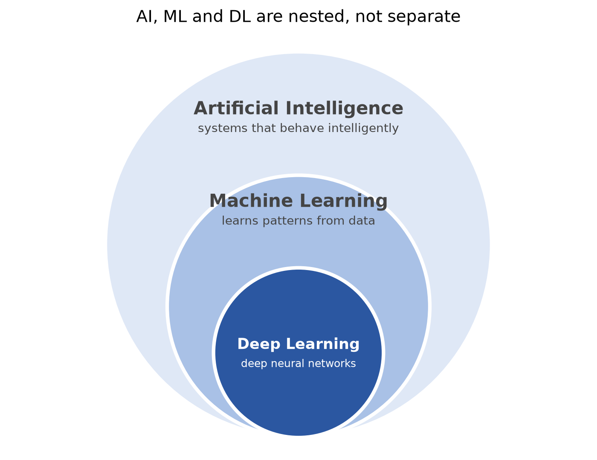
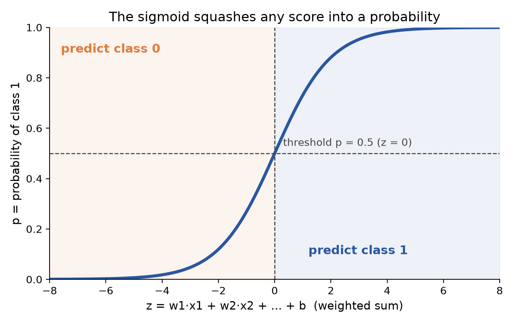
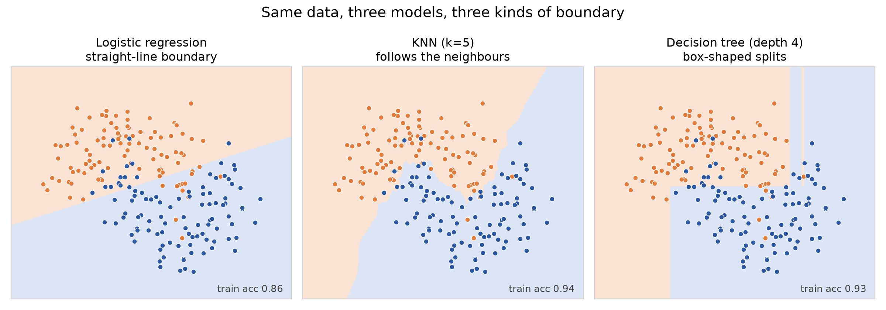
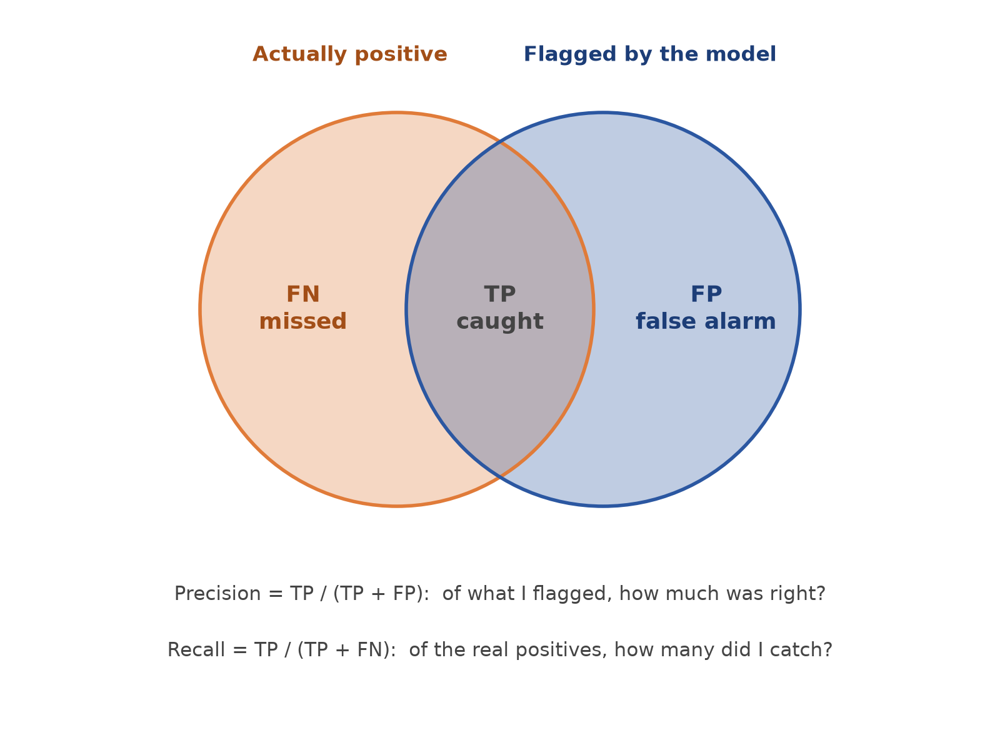
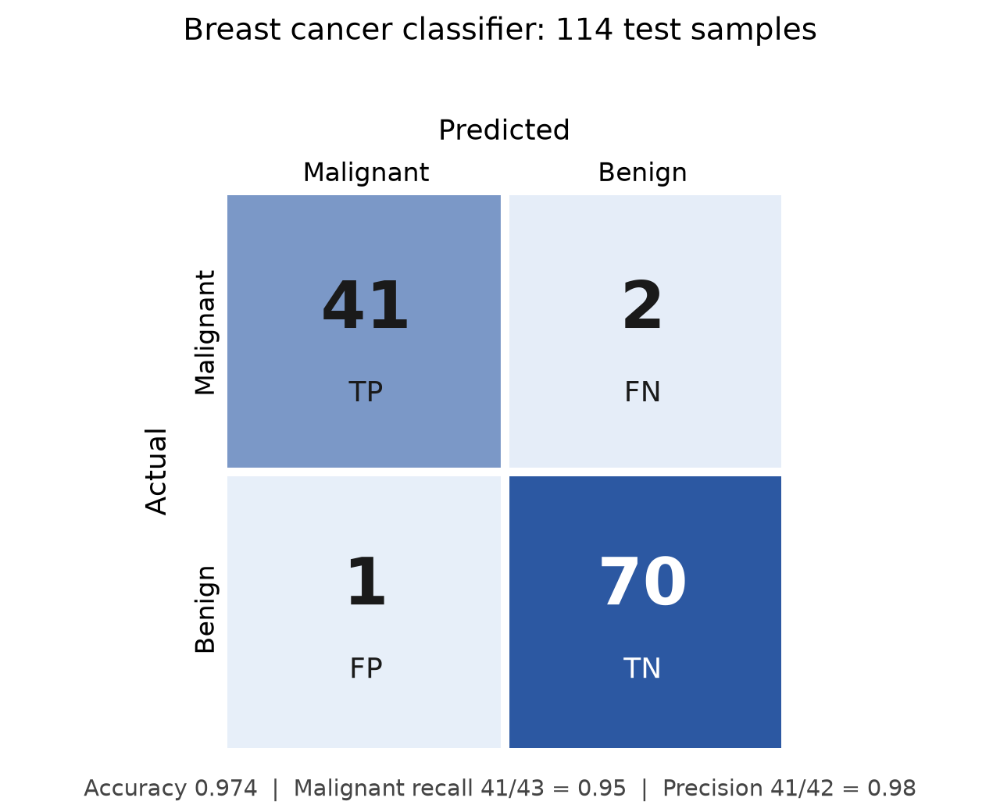

# From Rules to Learning: ML and DL Foundations

*What AI, machine learning and deep learning actually are, and how a first classifier gets built and judged.*

Everyone talks about AI, but few people can say where machine learning ends and deep learning begins, or why a model with 99.8% accuracy can still be useless. This article lays out the core ideas clearly enough that they click in about ten minutes, and ends with a working classifier you can run yourself.

## AI, ML and DL: nested, not separate

The three terms sit inside each other. AI is the broad goal of building systems that behave intelligently. Machine learning is one way of getting there: instead of writing rules, let the system learn from data. Deep learning is a kind of ML that uses many-layered neural networks and learns its own features.

A classic framing of AI uses four quadrants: systems that think humanly, think rationally, act humanly (the Turing Test), or act rationally. Modern AI mostly aims at acting rationally, meaning achieving the best outcome. AlphaGo is the standard example: it plays well, not necessarily like a human.



## Why we moved from rules to learning

Early "good old-fashioned AI" (GOFAI) encoded knowledge by hand: logic, if-then rules and semantic nets (graphs of concepts and relations). Expert systems tried to copy a human expert's decisions this way.

It hit a wall for three reasons:

- **Ambiguity.** Translation programs handled syntax but not meaning. A famous (possibly apocryphal) example turned "the spirit is willing but the flesh is weak" into "the vodka is good but the meat is rotten".
- **Scalability.** Toy examples did not scale to real-world complexity.
- **Brittle representations.** Rules and semantic nets could not handle uncertainty or common sense.

The result was a cycle often described as booms and winters: GOFAI in the 1960s, expert systems in the 80s, and then machine learning. Funding dried up twice. ML worked because it replaced hand-written knowledge with data.

## What "learning" means

Tom Mitchell's 1997 definition says a program learns from experience E with respect to task T and performance measure P if its performance on T, measured by P, improves with E.

Data is the fuel. It comes in three broad types: categorical (cat, dog), ordinal (tall, medium, short) and continuous (numeric ranges). Only a small fraction of the world's data is labelled, which matters in a moment.

## Supervised learning

Each training example comes with the right answer. The model learns a mapping from inputs X to outputs Y. There are two flavours:

- **Classification:** predict a category (cat vs dog, malignant vs benign).
- **Regression:** predict a number (house price).

The workflow is always the same. Raw data goes through a feature extractor into the model, and training produces learned parameters. At test time the parameters are frozen, the model predicts on unseen data, and we compare against the ground truth.

That is why we split the data into train and test sets. If you only ever measure on data the model has seen, you cannot tell whether it generalised or memorised. The split exists to catch overfitting and to evaluate generalisation.

The main weakness is the labelling bottleneck. Every example needs a human to tag it, and most data is unlabelled.

## Unsupervised learning

No labels. The model looks for structure on its own. Picture students lining up by height without being told where to stand: nobody gave the answer, yet an ordering emerges.

The main techniques are:

- **Clustering (K-Means, DBSCAN):** group similar items. Recommender systems are the classic example: people who bought one detective novel also bought others, with no human-defined categories.
- **Anomaly detection:** learn what "normal" looks like and flag anything far from it. This suits fraud, because fraud is rare (roughly 0.01% of transactions) and keeps changing, so you cannot label what you have not seen.
- **Dimensionality reduction (PCA, t-SNE):** real data is high-dimensional (a 224x224x3 image has about 150k values) and distances lose meaning there, a problem known as the curse of dimensionality. PCA finds orthogonal axes of maximum variance and keeps the top k, with no labels needed.

## Classification with logistic regression

Despite the name, logistic regression is a classifier. The intuition: compute a weighted sum of the features, squash it into a probability between 0 and 1, and pick the class on either side of a threshold.

The squashing function is the sigmoid:

```text
z = w1*x1 + w2*x2 + ... + b
p = 1 / (1 + e^(-z))
```



The decision boundary is where z = 0, which is a straight line (a hyperplane in more dimensions). That is the model's main limit: it assumes a linear boundary and simple relationships. Real data is often non-linear, noisy and complex, which is the motivation for trying other models.

One practical point: logistic regression is scale-sensitive, so standardise your features. That improves convergence and performance.

## KNN and decision trees

Two common next steps beyond logistic regression are K-Nearest Neighbours and decision trees. SVMs are a third popular alternative.

- **K-Nearest Neighbours:** to classify a new point, look at its k closest training points and take a majority vote. There is no real training step; the data is the model. Because it relies on distance, scaling matters here too. A typical setup is `KNeighborsClassifier(n_neighbors=5)`.
- **Decision tree:** a series of yes/no questions on features ("is this value above a threshold?") that splits the data into purer and purer groups. It can draw non-linear boundaries and is easy to read, but a deep tree can overfit.



## Evaluation: accuracy is not enough

A confusion matrix compares predictions with the truth. Rows are actual classes, columns are predicted, and each cell is a count. For a positive class, the four cells are:

- **TP (true positive):** actual positive, predicted positive.
- **FN (false negative):** actual positive, predicted negative.
- **FP (false positive):** actual negative, predicted positive.
- **TN (true negative):** actual negative, predicted negative.

From those four numbers come the standard metrics:

- **Accuracy** = (TP + TN) / total. Fine when classes are balanced.
- **Precision** = TP / (TP + FP). Of what I flagged, how much was right? Use it when false alarms are costly.
- **Recall** = TP / (TP + FN). Of the real positives, how many did I catch? Use it when missing one is dangerous, like disease screening.
- **F1** = 2PR / (P + R), the harmonic mean of precision (P) and recall (R). A single number when both errors matter and classes are imbalanced.



The example that makes accuracy's weakness stick: a search for "elephants in Africa" over 5,015 documents, with TP = 5, FN = 5, FP = 5, TN = 5,000. Accuracy is 5005/5015, about 99.8%, yet precision and recall are both 50%. True negatives swamp everything. Hence the old joke about building a 99.9999% accurate search engine cheaply: return nothing.

## Putting it together: a breast cancer classifier

The task is to predict whether a tumour is malignant or benign from measurements of cell nuclei. scikit-learn ships the data: 569 samples, 30 features. The label encoding is 0 = malignant, 1 = benign.

```python
from sklearn.datasets import load_breast_cancer
from sklearn.model_selection import train_test_split
from sklearn.preprocessing import StandardScaler
from sklearn.linear_model import LogisticRegression

data = load_breast_cancer()
X, y = data.data, data.target

X_train, X_test, y_train, y_test = train_test_split(
    X, y, test_size=0.2, random_state=42)

scaler = StandardScaler()
X_train = scaler.fit_transform(X_train)   # learn mean/std from train only
X_test = scaler.transform(X_test)         # reuse them on test

model = LogisticRegression(max_iter=1000)
model.fit(X_train, y_train)
y_pred = model.predict(X_test)
```

Three things are worth remembering:

- An 80/20 split is the standard choice, and `random_state=42` makes it reproducible.
- Call `fit_transform` on train and only `transform` on test. The scaler must not peek at test data.
- scikit-learn's consistent `fit` / `predict` API means swapping in KNN or a tree is a two-line change.

On the 114 test samples, accuracy is 0.974 and the confusion matrix is `[[41, 2], [1, 70]]`. Treating malignant as the class we care about: 41 malignant caught, 2 malignant wrongly called benign, 1 benign wrongly called malignant, and 70 benign correct. Malignant recall is 41/43 = 0.95 and precision is 41/42 = 0.98.



The two missed malignant cases are the costly mistakes, which is exactly why recall matters more than the headline accuracy here.

## Where deep learning comes in

Traditional ML has a bottleneck: a human decides which features matter (facial landmarks, TF-IDF weights, PCA axes), and a new domain needs a new expert. Deep learning asks whether the model can learn its own features end to end, raw data in, answer out. Think of an expert writing every rule for a great dish versus a child shown thousands of dishes who works out the signals alone.

The building block is the neuron: a weighted sum plus a bias, passed through an activation function.

```text
output = f(w.x + b)
```

Learning means adjusting the weights. A single perceptron (Rosenblatt, 1958) can only draw a straight line.

One point worth keeping straight: an activation does not curve a single neuron's boundary, which is still z = 0. Its job is to make depth meaningful. Without it, stacked linear layers collapse into one linear layer. With ReLU, layers compose, and many simple lines combine into complex shapes (four ReLU neurons can build a square).

The activation toolkit in brief:

- **Sigmoid:** suits binary outputs but is prone to vanishing gradients.
- **Tanh:** zero-centred but still saturates.
- **ReLU, max(0, z):** the default for hidden layers.
- **Leaky ReLU:** fixes dead neurons.

Training a network follows a loop: a forward pass, a loss computation (MSE for regression, cross-entropy for classification), backpropagation of gradients with the chain rule, and a weight update.

```text
w = w - lr * dL/dw
```

A natural next experiment is an `MLPClassifier` on the same data, trying different hidden layer sizes, activations and iteration counts.

## Quick recap

- AI is the goal, ML learns from data, DL is ML with deep neural networks that learn their own features.
- Rule-based AI failed on ambiguity, scale and brittleness, leading to two AI winters.
- Supervised learning uses labelled pairs (classification, regression); unsupervised learning finds structure without labels (clustering, anomaly detection, PCA).
- Always split train/test to measure generalisation, and fit the scaler on train only.
- Logistic regression: weighted sum, sigmoid, linear boundary. KNN: vote of nearest neighbours. Decision tree: a sequence of feature questions.
- Accuracy misleads on imbalanced data; use precision, recall and F1, and choose by which error costs more.
- Breast cancer result: 97.4% accuracy, confusion matrix `[[41, 2], [1, 70]]`.
- Activations make depth useful; ReLU is the default; training is forward pass, loss, backprop, gradient step.
