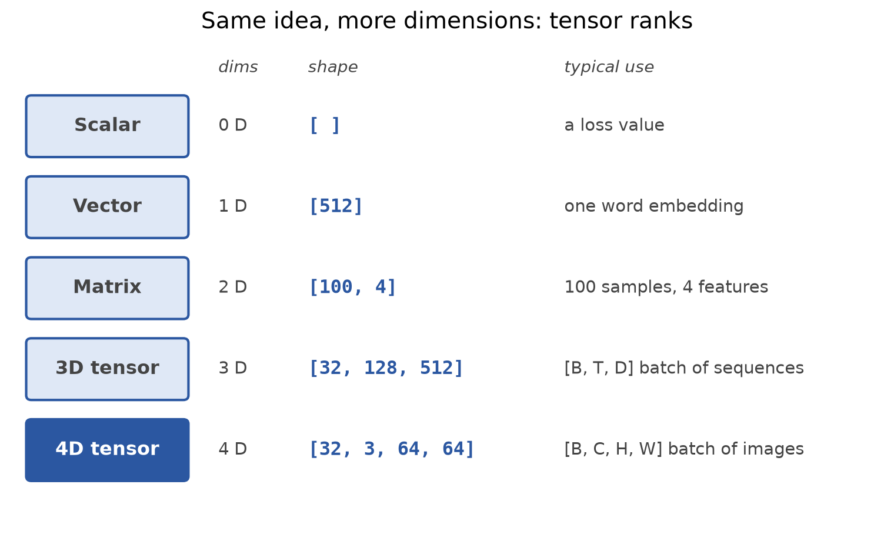
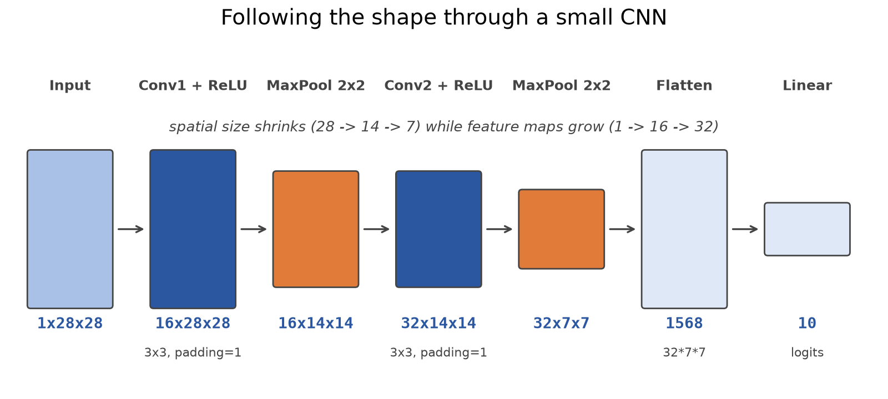
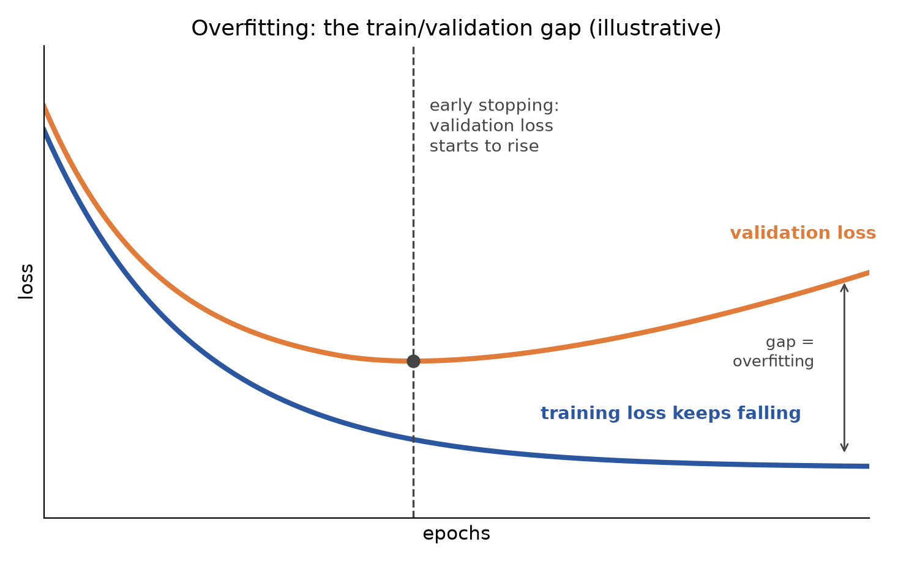
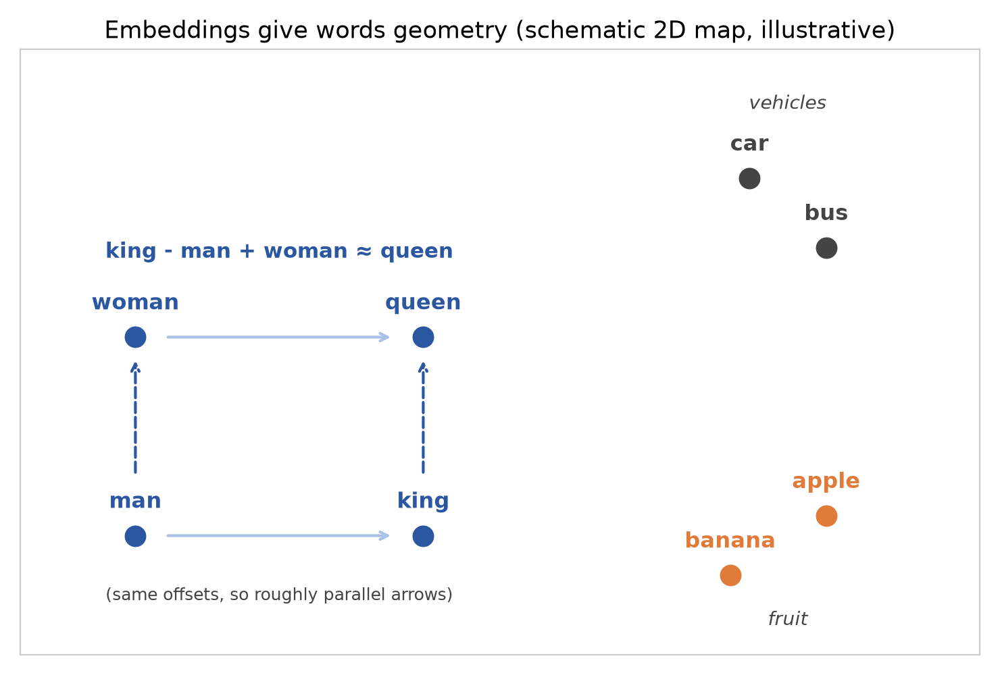
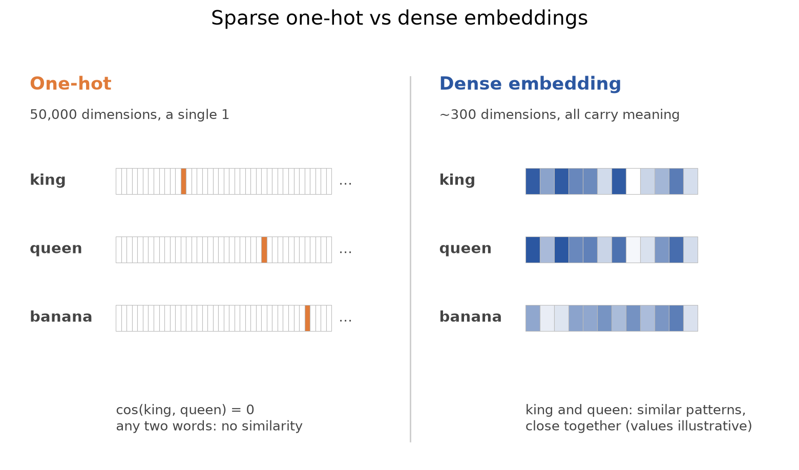

# Tensors, CNNs, Training and Embeddings: The Plumbing Under Every Modern Model

*Shapes, convolutions, how networks learn without memorising, and why words became vectors.*

Behind every impressive model sits a handful of unglamorous ideas that decide whether your code runs, whether your network learns, and whether your text means anything to a machine. Most beginner bugs live here, not in the fancy architecture. This article walks through the four pieces of plumbing worth knowing cold: tensors, convolutional networks, honest training, and embeddings.

## Tensors: one idea, five names

A tensor is just an N-dimensional array of numbers. The only thing that changes from one name to the next is the number of dimensions.

- **Scalar (0 dimensions):** shape `[]`, usually a loss value.
- **Vector (1 dimension):** shape `[512]`, for example one word embedding.
- **Matrix (2 dimensions):** shape `[100, 4]`, such as 100 samples with 4 features.
- **3D tensor:** shape `[32, 128, 512]`, a batch of sequences laid out as `[B, T, D]` (batch, time, dimension).
- **4D tensor:** shape `[32, 3, 64, 64]`, a batch of images laid out as `[B, C, H, W]` (batch, channels, height, width).



Every tensor has three attributes worth checking when something breaks: `.shape`, `.dtype` and `.device`. Weights are usually float32, class labels and indices are int64, and every tensor in an operation must live on the same device (CPU or GPU).

## Shape pitfalls

Shape errors are the number one source of trouble for people arriving in PyTorch from sklearn or NumPy. The classic trap is that `(5,)`, `(5,1)` and `(1,5)` hold the same five numbers but behave differently. `(5,)` is a flat vector with no row or column idea, `(5,1)` is a column and `(1,5)` is a row.

```python
a = torch.tensor([1., 2., 3., 4., 5.])  # (5,)
b = a.unsqueeze(1)                       # (5, 1)
c = a.unsqueeze(0)                       # (1, 5)
b @ c   # (5, 5) outer product
c @ b   # (1, 1) dot product
```

A few more habits will save you hours:

- **`*` is element-wise, `@` is matrix multiplication.** Mixing them up gives a valid-looking wrong answer.
- **`view` vs `reshape`:** `view` needs contiguous memory, while `reshape` works either way. A `-1` means "infer this dimension".
- **`squeeze()` removes all size-1 dimensions,** so name the dimension (`squeeze(1)`) when you only want one removed.
- **Broadcasting:** shapes are aligned from the right, and each dimension must match or be 1. `(3,5) + (5,)` works, `(3,5) + (4,)` fails.
- **The sklearn gotcha:** sklearn gives labels as `(N,)`, while a regression model outputs `(N,1)`. Reshape labels with `unsqueeze(1)` or `reshape(-1, 1)` before computing the loss, and print `.shape` after every conversion.

## Why PyTorch instead of sklearn

sklearn is great for tabular data and quick baselines. For deep learning, the usual reasons to move are arbitrary custom architectures, GPU support via `.to('cuda')`, autograd (automatic gradients) and minibatch training for data that does not fit in memory.

Autograd in miniature works like this: mark a tensor with `requires_grad=True`, run the forward pass, call `loss.backward()`, and the gradients appear in `.grad`. Around that, every PyTorch training loop is the same five steps:

```python
for epoch in range(EPOCHS):
    y_pred = model(X)          # 1. forward
    loss = loss_fn(y_pred, y)  # 2. loss (a scalar)
    optimizer.zero_grad()      # 3. clear old gradients
    loss.backward()            # 4. backprop
    optimizer.step()           # 5. update weights
```

A deeper network is not automatically a better one: on a small dataset, a 3-layer network can easily lose to a plain linear model. That leads straight into generalisation, below.

## CNNs: look locally, reuse the same detector

A convolutional neural network (CNN) is built for grid-shaped data, mainly images. Three ideas carry it:

- **Local connectivity:** each neuron looks at a small patch, not the whole image.
- **Shared weights:** one filter slides across every location, so the same edge detector works everywhere. That means far fewer parameters, and a learned feature is detected wherever it appears (translation equivariance).
- **Spatial hierarchy:** stacked layers go from edges, to textures and shapes, to object parts, to the final class.

The standard pipeline is Input, Conv, ReLU, Pool, (repeat), Flatten, Fully connected, Softmax. As you go deeper, spatial size shrinks and the number of feature maps grows.

**Convolution** is a dot product between a small kernel (say 3x3) and each patch of the input, slid across with a given stride. Its settings are kernel size, stride, padding and number of filters. The output size along one side is `(n + 2p - f) / s + 1`, rounded down, where n is the input size, p the padding, f the kernel size and s the stride.

**ReLU**, defined as `max(0, x)`, adds non-linearity and helps against vanishing gradients. **Max pooling** keeps the largest value in each window (2x2 with stride 2 turns a 4x4 map into 2x2), which cuts computation and adds some invariance to small shifts. The **fully connected layer** flattens the features and computes `W·x + b` to get one score per class, and softmax turns those scores into probabilities that sum to 1.

Here is a small PyTorch model, tracked by shape on a 28x28 grayscale image:

```python
self.conv1 = nn.Conv2d(1, 16, 3, padding=1)   # 1x28x28  -> 16x28x28
self.pool  = nn.MaxPool2d(2, 2)               #          -> 16x14x14
self.conv2 = nn.Conv2d(16, 32, 3, padding=1)  #          -> 32x14x14, pool -> 32x7x7
self.fc    = nn.Linear(32 * 7 * 7, 10)        # 1568 -> 10 logits
```



`padding=1` with a 3x3 kernel keeps height and width the same, so only pooling shrinks them. Flattening is `x.view(x.size(0), -1)`, which keeps the batch dimension.

CNNs shine at image classification, detection, segmentation and medical imaging. Landmarks include LeNet, AlexNet (2012), VGG and ResNet.

They struggle with fixed-size inputs, a weak sense of order and long-range dependencies. A word at position 1000 can only connect to position 1 through many stacked layers, which is hard to learn. CNNs can process sequences (1D convolutions exist); the issue is the number of hops. That gap is exactly what motivated RNNs and later Transformers.

## Training that generalises

The learning loop is simple: run a forward pass, compute the loss, backpropagate with the chain rule, and update with `w <- w - lr * dL/dw`. A useful split is that backprop supplies the direction (the gradients) while gradient descent takes the step. Training ends after a set number of epochs or through early stopping.

**Pick the loss by task:**

- **Regression:** mean squared error, `mean((y - ŷ)²)`, with no output activation (linear).
- **Two classes:** binary cross-entropy, with a sigmoid output.
- **Three or more exclusive classes:** categorical cross-entropy, `-Σ y_c log ŷ_c`, with a softmax output.

MSE squares errors, so big misses hurt most. Cross-entropy uses a log, so confident mistakes are punished hard: a true class predicted at 0.95 costs about 0.05, but predicted at 0.05 it costs about 3.0. With categorical cross-entropy only the true class's probability counts, so 0.70 costs about 0.36. We train on cross-entropy rather than accuracy because accuracy is not differentiable and gives gradient descent no direction.

**Parameters vs hyperparameters.** Parameters (weights and biases) are learned by the optimizer. Hyperparameters (learning rate, batch size, epochs, layers, dropout rate) are chosen by you before training.

**Three splits.** The training set (roughly 60-80% of the data) fits the weights. The validation set tunes hyperparameters and triggers early stopping. The test set is used once, at the end. Peeking at test data is leakage.

**Underfitting vs overfitting.** Underfitting is high bias: training and validation error are both high, so use a bigger model or train longer. Overfitting is high variance: training error is low but validation error is high, so regularise or add data. Total error decomposes into `Bias² + Variance + irreducible noise`. The classic overfitting signal is training loss falling while validation loss rises. If you see 98% training accuracy against 61% validation accuracy, reach for regularisation such as L2, not more layers, longer training, or dropping the validation set, which only hides the problem.



**The regularisation toolbox:**

- **L2 (Ridge):** adds `λΣw²` to the loss, shrinking weights smoothly but never to exactly zero.
- **L1 (Lasso):** adds `λΣ|w|`, pushing some weights to exactly zero, so it doubles as feature selection. The diamond-shaped constraint region has corners on the axes, which is why zeros happen.
- **Dropout:** randomly switches neurons off for one batch. Nothing is erased, and dropout is off at test time.
- **Early stopping:** choose a monitored metric and a patience value before training starts.
- **Batch norm, data augmentation (flip, crop, noise) and more data.**

Two small notes. The `alpha` argument in sklearn plays the same role as lambda: small means a weak penalty, large means a strong one and possible underfitting. And dropout is regularisation, not normalisation. Finally, normalise features that sit on very different scales, and in k-fold cross-validation remember that leakage creeps in when scaling or feature selection is done before the split.

## Embeddings: giving words geometry

**The problem with one-hot.** In one-hot encoding each word is a huge vector with a single 1. For a 50,000-word vocabulary that is 50,000 dimensions, almost all zeros. Any two one-hot vectors are orthogonal, so `cos(king, queen) = 0` and `cos(car, banana) = 0`. There is no similarity, no word order (it is a bag of words), and unseen words have no vector at all.



**The idea that fixes it** is a famous line from linguist J. R. Firth in 1957: "You shall know a word by the company it keeps." A word's meaning comes from the words around it. So we learn a short, dense vector (around 300 dimensions) for each word, arranged so that similar contexts give similar vectors. Then king and queen sit close together, and the well-known arithmetic works approximately:

```text
vec(king) - vec(man) + vec(woman) ≈ vec(queen)
```



**In code, an embedding is a lookup table:** a learnable matrix of shape `(vocab, dim)`.

```python
embedding = nn.Embedding(50_000, 300)
vectors = embedding(torch.tensor([42, 1337, 7]))  # shape (3, 300)
```

That table is about 60 MB of float32, and each word is a short dense row instead of a 50,000-long sparse one.

**Word2Vec** learns these vectors from raw text in two flavours:

- **Skip-gram:** the centre word predicts its context words. It works better for rare words.
- **CBOW (continuous bag of words):** the context words predict the centre word. It is faster and good for frequent words.

**The catch: static embeddings.** Word2Vec gives one vector per word whatever the sentence. "Bank" as in finance, river or aircraft is collapsed into a single averaged point, and at inference there is no mechanism to look at neighbouring words. A model trained on financial news will misread "fish by the bank". The fix is contextual embeddings, computed from the surrounding words, which is the doorway to modern language models.

## Quick recap

- A tensor is an N-D array; scalar, vector, matrix and image batch are the same thing at different ranks. Images are `[B, C, H, W]`, sequences `[B, T, D]`.
- Always check `.shape`, `.dtype` and `.device`. `(5,)`, `(5,1)` and `(1,5)` are different things, and `*` is not `@`.
- The training loop is forward, loss, `zero_grad`, `backward`, `step`. Autograd computes the gradients.
- A CNN is local filters plus shared weights plus pooling, building from edges to shapes to objects. It is weak on variable length, order and long-range dependencies.
- Match the loss to the task: MSE, binary cross-entropy (sigmoid) or categorical cross-entropy (softmax).
- Split into train, validation and test; use the train/validation gap to spot overfitting; fight it with L1/L2, dropout, early stopping, augmentation and more data.
- One-hot vectors are sparse and carry no similarity; dense embeddings put meaning into geometry; Word2Vec (skip-gram, CBOW) learns them but gives one static vector per word.
