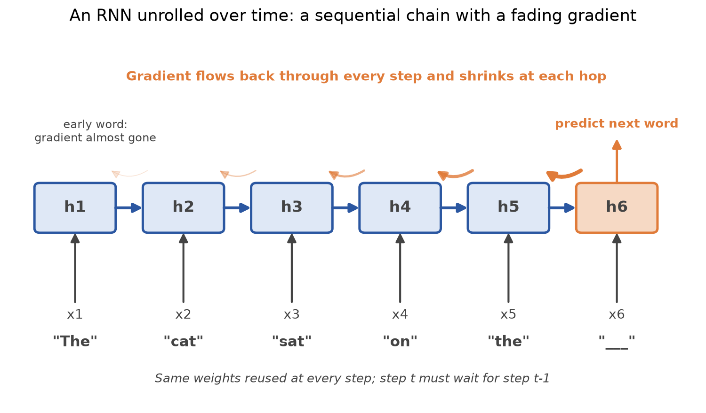
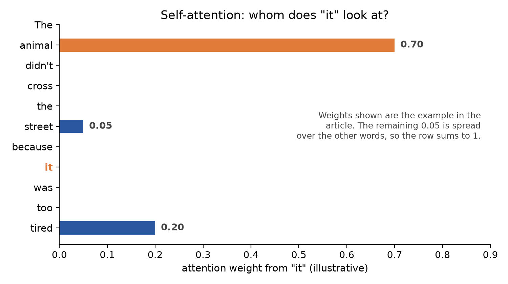
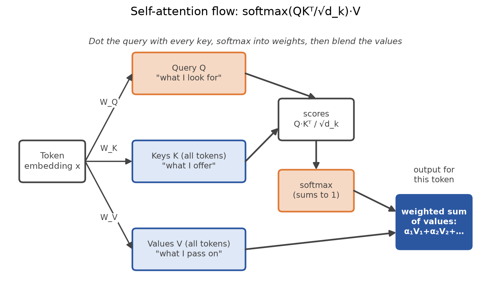
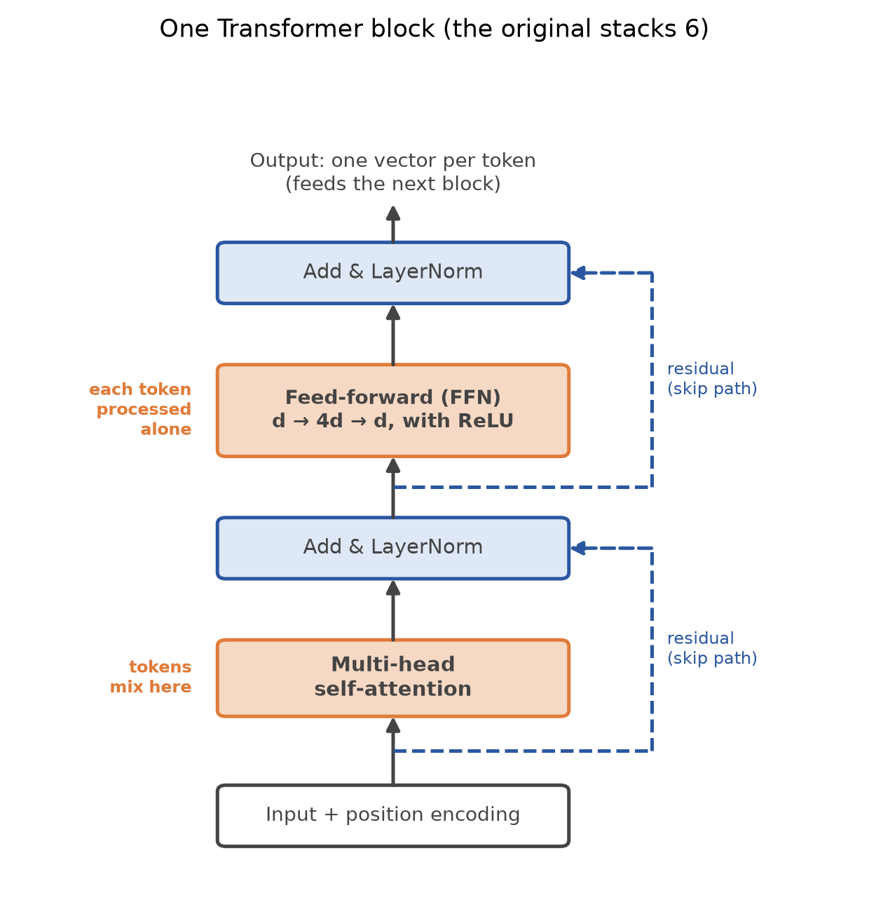
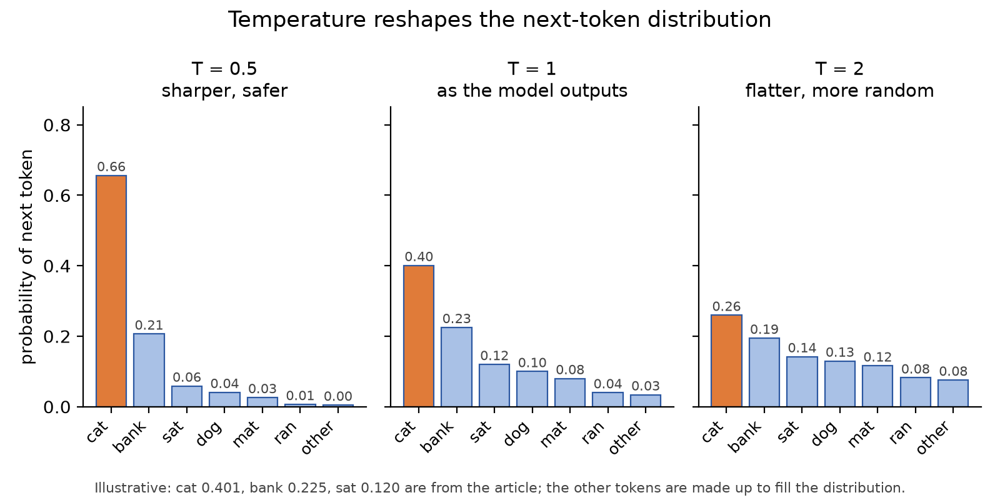

# From RNNs to Transformers: Attention, Architecture and Decoding

*Why recurrence hit a wall, how attention broke through it, and how a Transformer finally picks its words.*

Every modern language model rests on one idea: letting each word look directly at every other word. It took a chain of failures, from fading memory to slow training, before researchers got there. Follow that chain of problems and fixes, and you will understand what sits inside a Transformer block and how the model turns probabilities into text.

## Why sequences need memory

Take "The cat sat on the ___". Predicting the next word needs all the words so far. A plain feedforward network treats inputs as independent, so it fails here. We need a model with memory.

## The vanilla RNN

A recurrent neural network (RNN) reads one token at a time and carries a hidden state forward. The same weights are reused at every step.

```text
h_t = tanh( W_h · h_{t-1} + W_x · x_t + b )
y_t = g( W_y · h_t )
L   = - Σ_t log P(y_t | x_1 … x_t)
```

The hidden state `h_t` is the memory. The loss is cross-entropy summed over all timesteps.

Training uses backpropagation through time (BPTT). You unroll the network over T steps, compute the gradient at each step, sum them, and apply one weight update.

## Vanishing and exploding gradients

BPTT multiplies many derivatives `∂h_t/∂h_{t-1}` together, and that product is where trouble starts.

- **Vanishing gradient:** if the factors are below 1, the product shrinks exponentially. Gradients go to zero and the network cannot learn long-range dependencies.
- **Exploding gradient:** if the factors are above 1, the product blows up and weights turn into NaN. The standard fix is gradient clipping at a threshold.



LSTMs and gates are the partial remedy. An LSTM adds a cell state, a conveyor belt for memory, plus forget and input gates. The forget gate decides how much memory to keep (1) or erase (0):

```text
f_t = σ( W_f · [h_{t-1}, x_t] + b_f )
```

The gradient now flows as a product of forget gates, so memory lasts much longer. Roughly, a vanilla RNN remembers on the order of 10 to 20 steps, while gated networks stretch that to a few hundred.

Gates stretch the window. They do not remove the deeper problems below.

## The walls an LSTM still hits

- **Information bottleneck:** everything is compressed into one fixed-size vector. The vector for 1,000 tokens is the same size as the one for 10, so early tokens get overwritten. Even perfect gradient flow cannot recover information that is already lost.
- **No direct access:** to link token 10 to token 3, the signal passes through every step in between. The path length is O(n) and the signal dilutes at each hop.
- **No parallelism:** each step needs the previous one, so training is slow and hard to scale.

If doubling the hidden size does not fix long-document failure, the problem is structural, not capacity. You are making the bottle bigger, not removing the bottle.

## A bridge: contextual embeddings

Static embeddings like Word2Vec give "bank" one vector, always. ELMo (Peters et al., 2018) makes the vector depend on the whole sentence, using bidirectional LSTMs. In one illustrative example, the cosine similarity between "bank" (finance) and "bank" (river) was about 0.54, where a static embedding gives 1.0.

ELMo combines three layers with learned weights: a character CNN for word form, a lower BiLSTM for syntax and an upper BiLSTM for semantics. It was a major step, but it is still sequential, which paved the way for BERT-style models.

## Attention arrives

In plain seq2seq, the encoder squeezes the input into one context vector and the decoder must generate everything from it. That is the bottleneck again.

Attention (Bahdanau et al.) keeps all encoder hidden states `h_1 … h_n`. At each decoder step it computes a weighted sum:

```text
c_t = Σ_i α_i · h_i
α_i = softmax( score(s_{t-1}, h_i) )
```

A fresh context vector `c_t` is built at every step, focused on what is relevant. The bottleneck is gone.

Two limits remained. The encoder and decoder were still RNNs, with sequential processing and O(n) paths. And attention only ran from decoder to encoder, so tokens inside one sequence could not look at each other.

## Self-attention: Query, Key, Value

Self-attention lets every token look at every other token in the same sequence. Consider "The animal didn't cross the street because it was too tired." What does "it" mean? Compare "it" with every word, give "animal" a high weight, and build a meaning for "it" from those weights.

Each token produces three vectors:

- **Query (Q):** what I am looking for.
- **Key (K):** what I offer to be found by.
- **Value (V):** the content I actually pass along.

Think of attention as a fuzzy hashtable. A normal hashtable matches a query to exactly one key. Attention matches the query to every key to varying degrees and returns a sum of values weighted by the match.

```text
Attention(Q, K, V) = softmax( Q Kᵀ / √d_k ) · V
```

For "it", the scores might give weights like animal 0.70, tired 0.20, street 0.05. Then the output is `0.70·V_animal + 0.20·V_tired + ...`, meaning "something like animal, in the context of being tired".



The matrices `W_Q`, `W_K` and `W_V` that produce Q, K and V are learned. They start random and are trained by backpropagation. We do not compute them from words.



Why divide by √d_k? Dot products grow with dimension. Large scores push softmax into saturated regions where gradients are near zero. Scaling keeps the variance healthy.

## Multi-head attention

One head captures one kind of relationship, and language has many. So we run h heads in parallel with different projection matrices and concatenate the results:

```text
MultiHead(X) = Concat(head_1 … head_h) · W_O
head_i = softmax( Q_i K_iᵀ / √d_k ) V_i
```

Illustrative roles include coreference ("it" to "animal"), verb-object ("cross" to "street"), semantic similarity and nearby tokens. `W_O` mixes the concatenated heads back into one vector.

Nobody assigns these roles. Heads learn through gradient descent, specialisation is emergent, and nothing forbids two heads from learning the same pattern. Researchers can inspect what a head seems to do, but they do not directly set it.

## Positional encoding

Self-attention is permutation-invariant. Without position information, "The cat chased the mouse" and "The mouse chased the cat" look identical. RNNs got order for free from recurrence. Transformers dropped recurrence for parallelism, so position must be injected by adding a position vector to each word embedding. The original sinusoidal version is:

```text
PE(pos, 2j)   = sin( pos / 10000^(2j/d) )
PE(pos, 2j+1) = cos( pos / 10000^(2j/d) )
```

Each dimension pair is like a clock hand turning at a different speed. Fast dimensions separate nearby positions, and slow ones capture coarse, far-apart order. The encoding is deterministic, unique per position and bounded in [-1, 1]. Also, `PE(pos+k)` is a fixed linear (rotation) function of `PE(pos)`, so "look 4 tokens back" can be learned once and reused everywhere.

There are alternatives:

- **Learned embeddings:** used by BERT and GPT-2. No built-in relative property, and a fixed maximum length.
- **RoPE:** rotates Q and K so the dot product depends only on the distance i - j. Used in LLaMA, Mistral, Qwen and Gemma.
- **ALiBi:** subtracts a distance penalty from the attention score. Used in BLOOM and MPT.

RoPE and ALiBi never touch V.

## The block: FFN, residuals, LayerNorm

After attention, each token goes through a feed-forward network (FFN) on its own:

```text
FFN(x) = ReLU(x·W_1 + b_1) · W_2 + b_2
```

It expands dimension d to 4d and projects back. The 4x is a design choice from the original paper, not a law. The ReLU supplies the non-linearity, while the expansion itself is done by the learned linear layer.

Two tricks make deep stacks (6 blocks in the original) train well:

- **Residual connections:** add a sub-layer's input to its output. Gradients get a clean shortcut path.
- **Layer normalisation:** normalise each token's features as `γ·(x-μ)/σ + β`. The normalisation type is chosen before training, but γ and β are learned separately per layer.

Together with the √d_k scaling above, these keep training stable.



Where does the non-linearity live? Mostly in softmax and the FFN's ReLU. The Q/K/V projections, the weighted sum and the residual adds are linear.

## Encoder, decoder and cross-attention

The decoder block has three parts:

- **Masked self-attention:** a causal mask stops a position from seeing later tokens. The position "cat" can attend to "The" and "cat" only.
- **Cross-attention:** Q comes from the decoder, while K and V come from the encoder output. This is how the decoder reads the source sentence.
- **FFN:** the same feed-forward step as before, with a residual connection and normalisation around each part.

In self-attention, Q, K and V all come from the same sequence. The formula is the same, but the jobs differ: masking prevents peeking at the future, while cross-attention deliberately reads a different sequence in full.

In training the whole target is known, so all positions are computed in parallel under the causal mask. In generation the model must produce one token at a time. That is why a Transformer is highly parallel to train but sequential to generate.

Transformers come in three families:

- **Encoder-only:** bidirectional attention with no mask. Examples are BERT and RoBERTa. Good for classification, embeddings and ranking.
- **Decoder-only:** causal attention. Examples are GPT, Llama and Claude. Good for generation, chat and code.
- **Encoder-decoder:** encoder attention plus masked and cross-attention. Examples are T5 and the original Transformer. Good for translation and summarisation.

Choose by task shape, not output format. Decoder-only became the default because next-token prediction scales cleanly and prompting replaced per-task fine-tuning. Encoder models are not dead: they are cheaper and excellent for classification and search.

## Decoding: from logits to a word

At the end of the decoder, a linear layer maps the hidden vector to one score (a logit) per vocabulary word, and softmax turns scores into probabilities. In a tiny example, "cat" might come out at 0.401, "bank" at 0.225 and "sat" at 0.120.

Generation is an autoregressive loop:

```python
enc_out = model.encoder(src)              # encode source once
tgt = [[BOS]]
for _ in range(max_len):
    logits = model.decoder(tgt, enc_out, causal_mask(len(tgt)))[:, -1, :]
    next_tok = logits.argmax(-1)          # greedy choice
    tgt = append(tgt, next_tok)
    if next_tok == EOS: break
```

The encoder runs once, the mask is rebuilt as the target grows, and the loop stops at the end-of-sequence token or the maximum length. In practice, KV caching saves recomputing keys and values for earlier tokens.

How you pick the next token matters as much as the probabilities themselves:

- **Greedy:** always pick the top token (the `argmax` above). Fast and deterministic, but it can lock into a poor path.
- **Beam search:** keep the best B partial sequences at each step and score whole sequences. Better for translation-like tasks, but less varied.
- **Temperature:** divide logits by T before softmax. T below 1 sharpens the distribution (safer), and above 1 flattens it (more random).
- **Top-k:** sample only from the k most likely tokens.
- **Top-p (nucleus):** sample from the smallest set of tokens whose probabilities add up to p. The set size adapts to how confident the model is.



One caution on hallucination: the model predicts plausible tokens, not verified truth, and a wrong-but-plausible token can be picked at sampling time.

## Quick recap

- RNNs carry a hidden state and train with BPTT; gradients vanish (shrink) or explode (clip them).
- Gates (LSTM) lengthen memory but do not fix the fixed-size bottleneck, the O(n) path or the lack of parallelism.
- ELMo gave context-dependent word vectors with BiLSTMs; it was the bridge to BERT.
- Attention keeps all encoder states and builds a fresh context vector per step.
- Self-attention is `softmax(QKᵀ/√d_k)·V`. Q is what I look for, K is what I offer, V is what I pass on.
- Multi-head runs several attention patterns in parallel, then mixes them with `W_O`.
- Positional encoding restores word order; sinusoidal, learned, RoPE and ALiBi are the options.
- Each block has attention, an FFN (d to 4d to d), and residuals and LayerNorm around both.
- The decoder uses masked self-attention, then cross-attention (Q from decoder, K/V from encoder), then an FFN.
- Training is parallel; generation is sequential. Encoder-only, decoder-only and encoder-decoder models suit different tasks.
- Decoding options are greedy, beam search, temperature, top-k and top-p.
