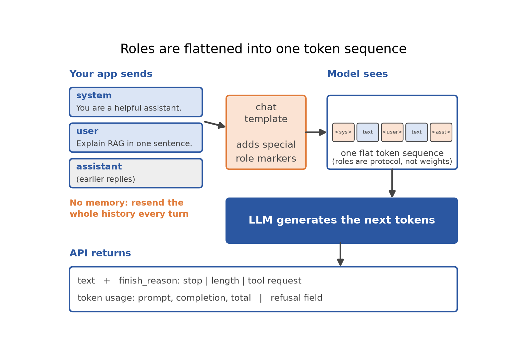
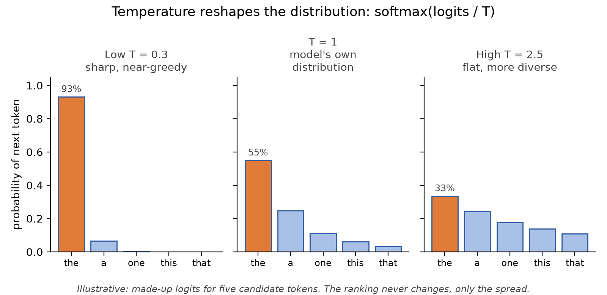
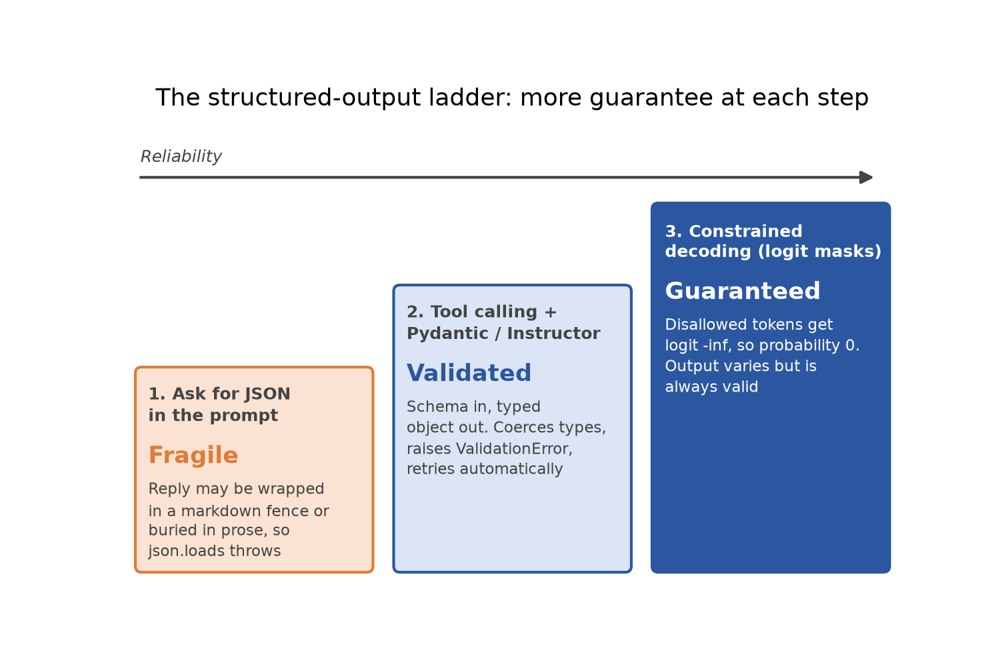
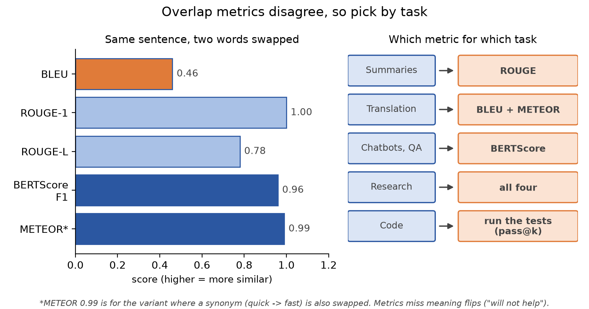
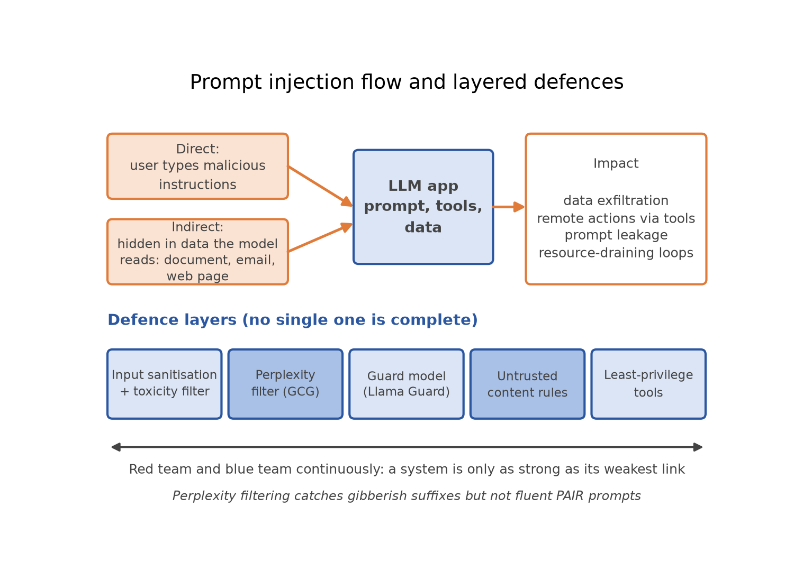

# Working with LLMs: APIs, Prompting, Evaluation and Security

*How to call a model, steer it, check that it is any good, and stop it being abused.*

Training a language model is a job for a few labs, but using one well is a job for everyone. A model called carelessly gives unpredictable text, breaks your parser, costs too much, and can be talked into things you never intended. This article covers the practical loop: calling a model, controlling generation, getting structured output, measuring quality, and defending the system.

## The API picture

An LLM API is a function: you send a list of messages and some settings, and you get text back plus metadata. Three families are common.

- **OpenAI:** the industry-standard hosted API, paid per token. It offers chat, tool calling, structured outputs, vision, audio and embeddings.
- **Anthropic (Claude):** the Messages API, where `max_tokens` is required. It also offers prompt caching and long context.
- **HuggingFace:** the hub for open models, plus the `transformers` library.

The minimal call looks much the same everywhere:

```python
resp = client.chat.completions.create(
    model="gpt-4o-mini",
    messages=[{"role": "system", "content": "You are a helpful assistant."},
              {"role": "user", "content": "Explain RAG in one sentence."}],
    temperature=0.7, max_tokens=200)
print(resp.choices[0].message.content)
```

**Roles.** `system` (and the newer `developer`) sets behaviour, tone and constraints. `user` is the human input. `assistant` holds the model's earlier replies, used to keep history or plant few-shot examples. Under the hood they are flattened into one token sequence by the chat template, so roles are protocol, not weights. The API also remembers nothing: your application resends the history every turn, which is why long chats cost more.



**Response metadata worth reading:** `finish_reason` (`stop` for a natural end, `length` if `max_tokens` cut the answer off, or a tool request), token usage (prompt, completion, total), and a `refusal` field.

**Three ways to run open models:**

- **`transformers` locally:** no internet, full privacy. Best for research, fine-tuning and seeing the model's internals.
- **HuggingFace hosted inference (router):** needs internet, and your data goes to HuggingFace. Rate limited, so best for quick prototypes.
- **Ollama:** local, full privacy, and the easy way to run 7B-class models day to day.

Its unique advantage is access to the real weights. Many servers (the HF router, Ollama, self-hosted servers) speak the OpenAI format, so switching often means changing only `base_url`.

## Sampling parameters

The model outputs a score (logit) per vocabulary token, softmax turns those into probabilities, and a decoding rule picks the next token.

- **Greedy:** always take the most likely token. Deterministic, but it can never undo a choice.
- **Beam search:** keep the `k` best partial sequences at each step. Deterministic, costlier, and not guaranteed to be globally optimal.
- **Random sampling:** draw from the distribution. The core trade-off is quality versus diversity: likely words are coherent but dull, while mid-probability words are creative but can drift.

**Temperature** divides the logits by T before softmax: `softmax(logits / T)`. Low T sharpens the distribution toward greedy; high T flattens it. T = 0 is handled as a special deterministic mode rather than a literal division by zero. It changes the shape of the distribution, not the length of the answer.



**Top-k** keeps a fixed number of the most likely tokens, renormalises, then samples. **Top-p (nucleus)** keeps the smallest set whose cumulative probability reaches p, so it keeps few tokens when the model is confident and more when it is unsure.

**Penalties** discourage repetition. A repetition penalty divides the logit of already-seen tokens, a frequency penalty subtracts in proportion to the count, and a presence penalty is the binary version.

**Max tokens and stop sequences.** `max_tokens` is a hard output cap, so truncation is possible (check `finish_reason`). Stop sequences end generation on a given string, which is handy for structured output. As a rough rule, one word is about 1.3 tokens.

Temperature starting points, not laws:

- **Classification and extraction:** 0
- **Summarisation and coding:** 0 to 0.3
- **Reasoning with self-consistency:** 0.5 to 0.8
- **Brainstorming and creative writing:** 0.8 and above

Use temperature plus one truncation method (top-p or top-k), not extreme values of both. And remember that sampling is not a hallucination fix: if the model assigns high probability to a wrong answer, a low top-p will still pick it. Hallucination needs grounding (retrieval, tools), verification, or constrained output.

## Prompting

A prompt has four parts: **instruction, context, input data, and an output indicator**. For example: "Classify the text into neutral, negative or positive" (instruction), "Text: I think the food was okay." (input), and "Sentiment:" (output indicator).

- **Zero-shot:** instruction only. A strong baseline that relies on pre-training knowledge.
- **Few-shot:** a handful of input-output examples in the prompt. Large models adapt this way with no weight updates, which is called in-context learning. Show a model that 2, 5, 8 and 11 are labelled ALPHA or BETA, and the examples teach the hidden rule.
- **Role prompting:** a system message such as "You are an exceptional ML instructor. Prioritise intuition and use one analogy." The same question gets a noticeably different style of answer.
- **Chain-of-thought:** "Think step by step." It helps with puzzles like the juggler problem (16 balls, half golf balls, half of those blue) that trip up a direct answer. A prompt that says "think step by step but show only the answer" contradicts itself and loses the benefit.

Few-shot has caveats: redundant or badly ordered examples can hurt, every example costs input tokens on every request, and examples guide format more than they guarantee facts.

Good task prompts share some habits. For question answering, say "Answer only from the context" and allow "Unsure". For summaries, name the audience, focus and length limit. For classification, give a fixed label list and ask for only the labels. For reasoning, add a step-by-step cue. Not every task suits prompting, though: forecasting stock prices is numeric time-series prediction, not language.

**Prompt optimisation is empirical, not magic.** A good test runs several candidate prompts over a small labelled set at temperature 0 and records two numbers: accuracy, and parse rate (how often an answer could be extracted at all). A tightly constrained prompt with a fallback tends to hold up across models, while an open-ended reasoning prompt can badly hurt a small model, partly because its answers become hard to parse. There is no provable "best prompt", so test on representative data. LLMs can propose candidates, but those still need external evaluation. Also, writing "temperature 0.2" inside a prompt does nothing; decoding settings are API parameters.

## Structured outputs

Free text breaks pipelines. Asking for JSON in plain text fails in two ways: the reply comes wrapped in a markdown fence, or the JSON is buried in prose, so `json.loads` throws.

**Tool (function) calling.** You describe a function with a JSON schema, and the model returns the function name and arguments as structured output. It does not run anything. Your application executes the function and sends the result back in a second call for the final answer. The loop is: user query, model selects a tool, your code runs it, the result goes back, the model answers.

**Pydantic** defines a typed schema that does three jobs. It coerces types ("10" becomes 10), raises clear `ValidationError`s (so a hallucinated "unknown" in an int field is caught early), and generates JSON Schema with `model_json_schema()`. A plain dataclass accepts wrong types silently.

```python
class PythonPackage(BaseModel):
    name: str
    author: str

# schema in, validated object out
Packages.model_validate_json(resp.choices[0].message.tool_calls[0].function.arguments)
```

**Instructor** wraps the client: pass `response_model=Packages` and get a typed object back, with automatic retries. Use descriptive field names, `Field(description=...)` and `Optional` for uncertain fields. An `Enum` stops a model inventing categories, for instance when extracting an invoice from a PDF. Ollama's `format=schema` does the same job for small local models.

**Constrained decoding** is the strongest guarantee. At each step, set the logit of every disallowed token to minus infinity, so softmax gives it probability 0. A `LogitsProcessor` can do this with an allow-list (digits only) or a regex checked with partial matching, so an incomplete URL like `http://test.` is still allowed to continue. Outputs still vary but are always valid.

Simple masks have limits: no lookahead and no state tracking. Proper structured decoding compiles a schema or grammar into a state machine with precomputed masks per state. This is what strict structured outputs from providers like OpenAI rely on: required keys are tracked, types enforced, and generation ends only when the output is valid. Use simple masks for flat constraints and structured decoding for JSON and nested schemas.



## Evaluation

Evaluation covers output quality (coherence, factuality, instruction following) and system performance (latency, price, reliability). Here we focus on quality.

**Human ratings** are the gold standard but subjective. Agreement between annotators is measured with Cohen's kappa:

```text
kappa = (Po - Pe) / (1 - Pe)
```

Po is observed agreement and Pe is the agreement expected by chance. Kappa can be low even when raw agreement is high, if one label dominates: two doctors agreeing on 18 of 20 patients gave a kappa of only 0.44, because chance agreement was already 0.82. It is meaningful only if raters judge independently.

**Precision and recall** underpin the text metrics. Precision is the share of candidate words found in the reference, and recall is the share of reference words found in the candidate.

- **ROUGE** (recall-oriented): ROUGE-N is matched n-grams divided by reference n-grams, and ROUGE-L uses the longest common subsequence, so word order matters. Best for summarisation.
- **BLEU** (precision-oriented): n-gram precision with a brevity penalty, where the penalty is 1 if the candidate is at least as long as the reference and exp(1 - r/c) otherwise. Best for translation, and it supports multiple references.
- **METEOR:** a harmonic mean of precision and recall weighted toward recall, plus stem and WordNet synonym matching, with a penalty for fragmented matches.
- **BERTScore:** embeds tokens with BERT, takes pairwise cosine similarity, greedy-matches, and reports precision, recall and F1. The best semantic fit, and the slowest.

Take a sentence with two words ("dog" and "fox") swapped. BLEU gives 0.46, ROUGE-1 gives 1.0 but ROUGE-L 0.78, and BERTScore F1 gives 0.96, while METEOR reaches 0.99 when a synonym ("quick" to "fast") is also swapped.



As a rule of thumb, use ROUGE for summaries, BLEU plus METEOR for translation, BERTScore for chatbots and QA, and all four for research. Their shared flaw is that they compare similarity to a reference and correlate imperfectly with humans. The classic trap is "will help" versus "will not help": high overlap, opposite meaning. For code, run the tests (pass@k on HumanEval) instead of using BLEU.

**LLM-as-a-judge** asks a model to rate output against criteria such as relevance, factuality, tone and safety, returning a rationale and a score. It can be **pointwise** (score one response) or **pairwise** (A versus B). Use it for qualitative text, but not where a deterministic check exists, such as running generated code against a test case.

## Safety and prompt security

The frame is the **CIA triad**: confidentiality, integrity and availability. A threat model asks what the attacker can access, observe and want; the fewer assumptions an attack needs, the more dangerous it is.

**Classic ML threats** include membership inference (was this example in the training set?), model extraction and distillation (query a model to clone it), data and model poisoning, model hijacking (hidden trigger behaviour), and adversarial perturbations (a tiny change flips a classifier).

**LLM-specific risks** include leaking confidential data into chat tools or code assistants, jailbreaks, brand damage, unsafe user experiences, "shadow AI" and IP leakage.

**Prompt injection.** Direct injection is the user typing malicious instructions. **Indirect injection** hides instructions in external data the model reads, such as a document, email, web page or API response, sometimes invisible to humans. Consequences include data exfiltration, remote actions through connected tools, resource-draining loops, and social engineering (a resume that manipulates an AI screener). **Prompt leakage** extracts the system prompt, which is both IP loss and reconnaissance. The Remember-the-Start attack avoids trigger words like "ignore" or "repeat": it feeds in the opening of the prompt and asks the model to continue, so keyword-based refusals miss it. One proposed mitigation, SysVec, removes the prompt from the text context and injects it as a hidden vector instead.

**Attacks by access level:**

- **White-box (gradients available):** HotFlip, TextFooler, and **GCG**, which appends a gibberish suffix and picks token swaps by gradient to push the model toward an affirmative start ("Sure, here is..."). Suffixes found on open models transferred to closed APIs.
- **Black-box (queries only):** low-resource-language jailbreaks (for example Zulu), past-tense rephrasing, context contamination (a few harmful examples in context), DeepWordBug (character typos), and **PAIR**, where an attacker LLM proposes a prompt, the target answers, a judge scores it, and the loop refines the prompt, often within about twenty queries. PAIR prompts are fluent, unlike GCG's gibberish.

**Jailbreak techniques fall into four families:** language strategies (payload smuggling, stylising prompts), rhetoric (innocent purpose, persuasion, Socratic questioning), imaginary worlds (hypotheticals, storytelling, roleplay), and operational exploitation (few-shot priming, "superior model" personas like DAN).

**Mitigations:**

- Red team (attack) and blue team (defend) continuously, because a system is only as strong as its weakest link.
- **Perplexity filtering:** GCG suffixes are gibberish, so very high perplexity flags them. It does not catch fluent PAIR prompts.
- **Guard models** such as Llama Guard classify prompts and replies against hazard categories.
- Input sanitisation and toxicity filters such as the Perspective API.
- Treat all retrieved or uploaded content as untrusted, and grant tools least privilege.



No single defence is complete, and whether LLMs can ever be made truly secure is an open question. The practical takeaway is to assume attacks will arrive and layer your defences.

## Tokens, cost and model choice

Cost is mostly tokens, and a few principles go a long way:

- Input and output tokens are both billed. Resent chat history and big documents multiply input cost, so chunk, summarise, cache where supported, and retrieve (RAG) instead of pasting everything.
- Few-shot examples are paid for on every call, so for high-volume classification a small fine-tuned model may be cheaper.
- Reasoning models spend extra hidden thinking tokens, which raises latency and cost. Their main drawback is time and tokens, not weaker reasoning.
- To budget, measure input and output tokens on representative and worst-case samples, leave headroom in `max_tokens`, detect truncation, and route easy requests to smaller models.
- Choose models by testing on a fixed evaluation set against a minimum quality bar, then trade quality, cost and latency. Report the mean and variability over repeated runs, since outputs are stochastic.

## Quick recap

- An LLM API takes messages plus settings and returns text, `finish_reason` and token usage. Roles are protocol, and history is resent each turn.
- Open models run via local `transformers`, the HF router, or Ollama, often through an OpenAI-style client.
- Temperature is `softmax(logits / T)`; top-k keeps a fixed count, top-p keeps a probability mass; penalties curb repetition; `max_tokens` and stop sequences bound output. Sampling does not fix hallucination.
- Zero-shot, few-shot, role and step-by-step prompts are tools. Optimise prompts by measuring accuracy and parse rate, not by guesswork.
- Structured output ladder: ask for JSON (fragile), tool calling with Pydantic and Instructor (validated), constrained decoding with logit masks (guaranteed). Tools are executed by your code, not the model.
- Evaluation: ROUGE for summaries, BLEU for translation, METEOR for stems and synonyms, BERTScore for semantics, Cohen's kappa for annotators, LLM-as-a-judge for qualitative text. Metrics miss meaning flips.
- Security: the CIA triad, direct versus indirect prompt injection, prompt leakage, white-box (GCG) and black-box (PAIR, low-resource languages) attacks, and layered defences including red teaming, perplexity filters and guard models.
- Cost follows tokens: trim context, cache, retrieve, route to smaller models, and budget from measured usage.
